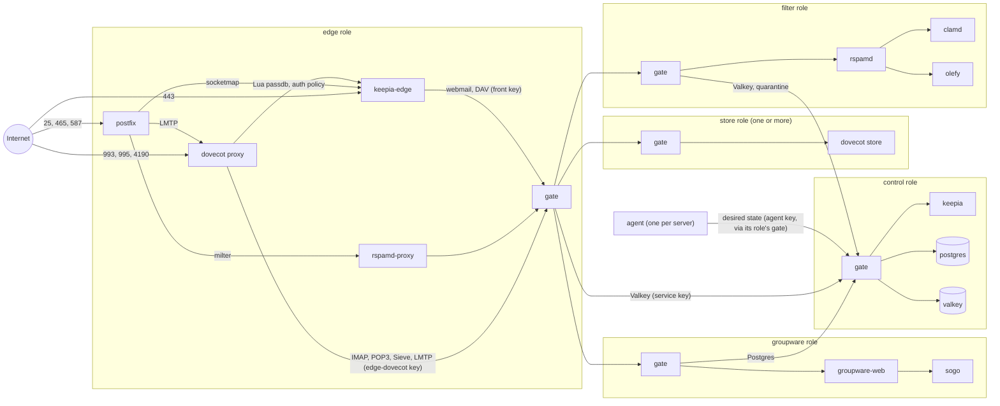
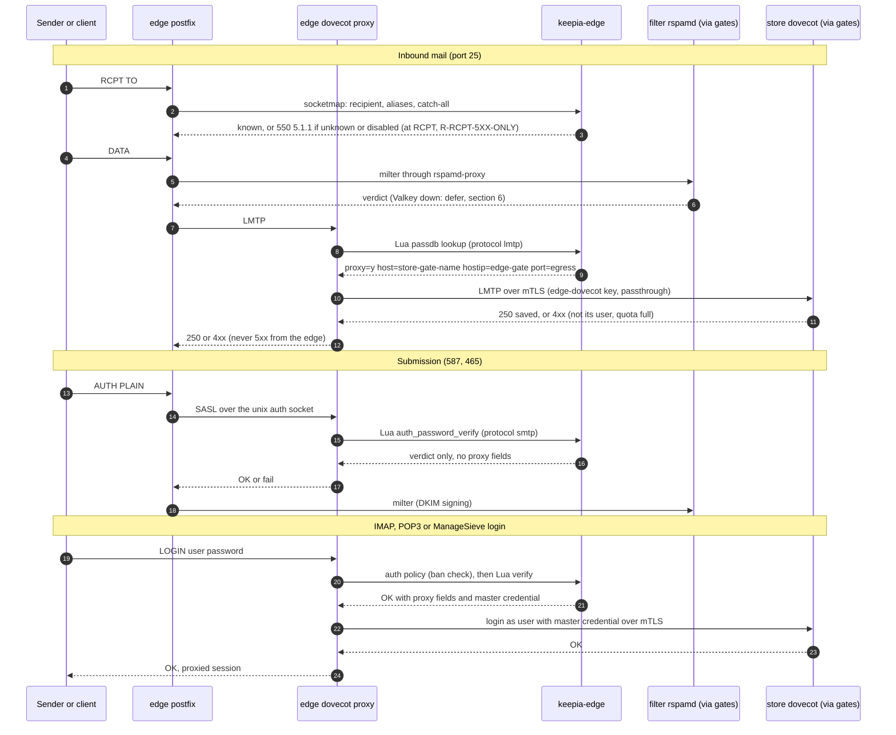

# Architecture

Keepia Mail runs on one server first and spreads over several servers later,
with the same images and the same Compose file. This document is the single
source of the architecture: roles, placement and routing, lookups,
authentication, the agent, internal transport, shared state, Docker, the
Dovecot 2.4 constraints, the resource budget, the data model, the 1.0 scope
and the security properties.

Plan: [#2, plan comment][plan] (Revision 7 with the N24 wording), approved in
[the plan review][approval]. Where a later implementation is already planned,
the [coordinator note on reload paths][cnote] is folded in (section 5).

Amended for 0.2.0 by #94 ([plan][p94]), which records the maintainer's 0.2.0
decisions ([#93][i93]) and the decisions of #95 and #96 that other plans
cite.

## How to use this document

**Citing it.** Later plans and reviews cite a section by its number ("#2
section 5a") and a rule by its name (`R-ROUTE-VALID`). A change to a decision
here is a pull request against this file, with its own plan; a later plan
that needs another choice says so and names the section it changes.

**The resource budget is binding.** Every plan states its memory and CPU cost
per role and for "all roles on one server" against the budget in
[section 9](#9-resource-budget) (`CLAUDE.md`, "Rules").

**Format of each decision.** Each choice between alternatives is written as
decision, rejected alternative, why, and source. "Rejected:" introduces every
alternative that was not taken.

**Nothing here is run code.** #2 ships this document. The milestone named at
each rule builds and tests it.

### Labels of values

- **(measured)**: observed in the prototypes #3 and #4, in the review of #18,
  in #13 or in the plan reviews of #2, with the cited source.
- **(upstream)**: from upstream documentation, not run here.
- **(predicted)**: an estimate, to be measured where the text says.

### Maintainer decisions

The maintainer answered the plan's questions M1 to M5 in
[the decision comment][mdec] (6816994463). This document is written to these
decisions.

| Question | Topic | Decision | Applied in |
|---|---|---|---|
| M1 | Trust boundaries: who holds which secret and who verifies passwords | Approved as recommended; all listed risks accepted, including the two added in PR #36 | sections [4](#4-authentication-who-verifies-passwords), [4a](#4a-groupware-logins-webmail-and-dav), [5](#5-agent-and-control-plane) |
| M2 | Refined security properties and ban behaviour on Valkey loss | The refined five properties are binding; bans fail open with the per-edge counter | sections [6](#6-shared-state-postgres-and-valkey-only), [13](#13-security-properties) |
| M3 | MTA-STS in 1.0: publish only, or also enforce outbound | 1.0 publishes and also enforces receivers' policies outbound, in `keepia-edge`'s TLS-policy socketmap; no new component | sections [12](#12-the-10-feature-scope-mapped-to-roles), [14](#14-external-services-the-architecture-implies) |
| M4 | Does the reference server meet the all-roles minimum (answered in chat only, no values on GitHub) | Confirmed (for #2's 8 GiB minimum) | section [9](#9-resource-budget) |
| M5 | Write method for new mail | Crypt only, for new mail | section [8](#8-dovecot-24-constraints) |

### Maintainer decisions for 0.2.0

| Topic | Decision | Applied in |
|---|---|---|
| Outbound mail to the internet | Moves to 0.3.0, with DNS recursion and DKIM. In 0.2.0, external recipients are deferred, not bounced. | §12 |
| ManageSieve, Sieve execution, internal submission | Move to 0.4.0 | §5a, §6, §12 |
| Placement | Automatic: lowest allocated quota, then fewest mailboxes, then name. `--store` overrides. | §2 |
| Full mailbox | 4xx (defer) | §2, §13 |
| Public TLS | Let's Encrypt in 0.2.0 with TLS-ALPN-01 on 443, and a pinned Pebble in CI | §1, §5a, §14 |
| Passwords | New passwords use Argon2id, m=64 MiB, t=3. Verification accepts bcrypt, SHA-crypt and SSHA, with a rehash on login. App passwords come in 0.4.0. | §4, §9 |
| Minimum server | 12 GiB RAM, 2 vCPU | §9 |
| mail_crypt key | One global pair, as before. `secrets export` and a first-start warning. | §5, §8 |
| Alias targets | Keepia addresses only. External forwarding needs SRS (0.3.0). | §10 |
| Disabled mailbox or domain | `550 5.1.1` at RCPT, the same as unknown ([6875672751][d95q1]) | §2, §3, §10, §13 |
| Edge Dovecot without a CRL check of store-gate certificates | Accepted, with two conditions ([6875671914][d96q1]) | §4 |

The source of every row is [#93][i93] (body, "Maintainer decisions
(2026-11-14)") unless the row names a comment.

### Sources

The prototype findings are cited by finding number; the links are at the end
of this file.

| Short form | Source |
|---|---|
| #3 F1 to F8 | [Findings of the Dovecot proxy prototype (#3)][p3] |
| #4 F1 to F7 | [Results of the mail_crypt prototype (#4)][p4] |
| #18 review | [Review of PR #18][r18] (routing table failures, N1 and N2) |
| #13 integrity | [#13 comment on read-time integrity][p13hash] |
| review 1 to review 7 | The plan reviews of #2, in order: [review 1][rv1], [review 2][rv2], [review 3][rv3], [review 4][rv4], [review 5][rv5], [review 6][rv6], [review 7][rv7], [approval][approval] |
| Coordinator decisions on #2 | [T1 to T10][cd] |
| Maintainer decisions on #2 | [M1 to M5][mdec] |
| Reviews of PR #36 | [first review][ra36], [second review][rb36] (findings on this document; no measured values cited from them) |

Prototype files are cited as permalinks to commit `46ebffe`, so the citations
survive #5 removing `prototypes/`.

## 1. Roles and components

| Role | Containers | Purpose |
|---|---|---|
| **control** | `keepia` (`keepia-mail serve`: API, admin UI, the internal anchors (section 5a), the key-encryption key and the sealed secrets (section 5), ACME client, desired-state API for agents), `postgres`, `valkey` | The only authoritative state. |
| **edge** | `postfix` (MX 25, submission 587/465), `dovecot` (proxy only: IMAP, POP3, ManageSieve, LMTP proxy), `keepia-edge` (`keepia-mail edge`: Postfix socketmap, Dovecot auth backend, Dovecot auth-policy server, HTTPS front for autoconfig/autodiscover, MTA-STS, the ACME TLS-ALPN-01 challenge on 443 (0.2.0; #102 decides which edge container answers it), reverse proxy to admin UI and webmail), `rspamd-proxy` (milter) | Internet-facing; stateless apart from the Postfix queue. |
| **store** | `dovecot` (mail storage, LMTP, Sieve/Pigeonhole, mail_crypt and mail_compress) | Holds the mailboxes placed on it. |
| **filter** | `rspamd` (normal workers), `clamd` (with freshclam), `olefy` | Scanning, DKIM signing, Bayes, greylisting, rate limits. |
| **groupware** | `sogo`, `memcached`, `groupware-web` (static files, in front of `sogod`) | Webmail, CalDAV/CardDAV, vacation and filters through ManageSieve. Reached only through the edge's HTTPS front, which authenticates (section 4a). |
| every role | `gate` (`keepia-mail gate`, section 5a) | The role's only listener for other roles: mTLS with per-purpose anchors. |
| edge, filter, control | `unbound` (one per role, validating resolver) | DNSSEC and DNSBL resolution for that role only (section 5a). |
| every server | `agent` (`keepia-mail agent`) | Configuration, keys, certificates. |

- **Start configuration:** all roles on one server, with the same images and
  the same Compose file as a multi-server deployment (section 7).
- **Decision: the Go binary is one image with modes** (`serve`, `edge`,
  `gate`, `agent`, CLI). **Rejected:** separate images per Go component,
  because the release pipeline (#5) and pinning are simpler with one Go
  image, and mail-archive ships one binary too
  ([mail-archive `docs/development/architecture.md:3`][ma-arch]).
- **Decision: the HTTPS front on the edge is the Go service.** **Rejected:**
  nginx or Caddy as an extra image (mailcow uses nginx), because the routes
  are few and the Go service has the per-domain data. SOGo's static files get
  their own `groupware-web`, reachable only through the groupware's gate.

### Role and connection map

Every arrow between roles passes two gates: the caller's own gate (egress)
and the callee's gate (section 5a). Inside a role, containers talk over the
role's private network.



## 2. Placement and routing

- **Every mailbox has exactly one `store_id` in Postgres.** No shared file
  system for mail.
- **Placement** ([#93][i93]; #95 [CD5][p95a], [CD13][p95]): a new mailbox
  goes to the eligible store with the lowest sum of allocated quota, then the
  fewest mailboxes, then the lowest gate name in byte order.
  - Eligible means state `active`, on a server that has not been removed.
  - An unlimited mailbox (quota 0) counts as 10 GiB, and disabled mailboxes
    count.
  - `mailbox add --store <gate-name>` overrides the choice, and it must name
    an eligible store.
  - There is no per-domain pinning. A mailbox's store is fixed until moves
    arrive in 1.1.0.
  - One lock serializes concurrent adds, so they cannot all choose the same
    store.
- **The edge looks up the route on every login and every LMTP delivery** from
  its local replica (section 3), with Dovecot's auth cache **off**
  (`auth_cache_size = 0`). Source: passwd-file was not cached on 2.4.5
  ([#3 F2][p3], confirmed in the [#18 review][r18]); SQL and Lua may use the
  cache (predicted), so the edge keeps it off. With the cache off a move
  needs no `doveadm auth cache flush`.
- **Decision: LMTP delivery goes Postfix → edge Dovecot `lmtp_proxy` →
  store** (measured in [#3 F5][p3]: delivered exactly once after recovery).
  **Rejected:** Postfix `transport_maps` straight to the store, because
  routing would then live in two places (Postfix and Dovecot) that a move must
  switch together.

### Routing rules

Requirements carried from #3 and the review of #18, written as rules with
their source and the milestone test that proves them.

- **R-EDGE-NO-STORAGE** ([#3 F3][p3], measured): the edge's `dovecot.conf`
  replaces the image's file wholesale and sets no `mail_driver`, `mail_home`,
  `mail_path` or userdb. `lmtp_proxy` falls back to local delivery for an
  entry without `proxy`, and with storage configured that stored a test
  user's mail on the edge. The edge's `/srv/vmail` is a named, empty volume
  ([`prototypes/dovecot-proxy/compose.yml:26-28`][proto-vmail] shows the
  named volume of the prototype). **Test:** the Compose test of #5 and 0.2.0
  asserts the volume stays empty, as #3's check 7 did.
- **R-ROUTE-COMPLETE** ([#3 F3][p3]): the lookup code returns either "user
  unknown" or an entry with `proxy=y` and `host`; no code path returns a found
  user without both. **Test:** one unit test per path in 0.2.0.
- **R-PROXY-FIELDS-SCOPE** ([review 1, B2][rv1], measured: passdb extra
  fields, `master=` and `pass=` included, are returned over the auth-client
  socket): `keepia-edge` returns the proxy fields `proxy`, `host`, `master`,
  `pass` **only** when `req.protocol` is `imap`, `pop3`, `sieve` or `lmtp`
  (`req.service` is `nil` on 2.4, [review 2][rv2], measured). For `smtp` and
  every other protocol it returns only the verdict. **Test (0.2.0):** the SASL
  reply for `service=smtp` carries no `proxy`, `host`, `master` or `pass`
  field; counter-proof: the same user over `service=imap` gets them. **This
  prevents an accidental leak only:** protocol, `rip`, `lport`, `secured` and
  `valid-client-cert` are asserted by whoever connects (measured,
  [review 2][rv2]), so a caller with one user's password can obtain the master
  credential. The real protection is R-AUTH-SOCKET, R-STORE-KEY-EDGE-DOVECOT
  and section 5a.
- **R-AUTH-SOCKET** ([review 2, B4][rv2]; [review 3, N13][rv3]): the edge's auth
  sockets are unix sockets on a volume of their own (never the mail volume),
  shared **only** by the edge's Dovecot and Postfix containers, `mode = 0660`
  with a group the Postfix image's user has (#5 fixes the gid); never an
  `inet_listener`. The client-asserted fields, `rip` for bans included, are
  then as trustworthy as those two containers. **Test (0.2.0):** no other
  container can connect (measured as enforceable, [review 3][rv3], probe 1).
- **R-STORE-KEY-EDGE-DOVECOT** ([review 2, B4][rv2]): the edge's client key for
  the stores' listeners (section 4) is mounted **only** into the edge Dovecot
  container (the agent writes it into a volume no other container mounts),
  not into Postfix, `keepia-edge` or any other container. A leaked master
  credential without that key opens no store. **Test (0.2.0):** the key file
  is absent from the Postfix and `keepia-edge` containers, and a store refuses
  a connection without it.
- **R-TRUST-ANCHORS** ([review 3, B6][rv3], measured on 2.4.5: a CA check
  admits every clientAuth or no-EKU certificate that CA issued; an
  intermediate under a shared root does not narrow it): one dedicated
  self-signed anchor per purpose, the narrowest EKUs, and two distinct client
  certificates per edge (`edge-dovecot → store`, key only in the edge Dovecot
  container; `keepia-edge → groupware`, key only in `keepia-edge`).
  **Enforced only by the gates of section 5a**, never by an application's own
  client-certificate check: Dovecot enforced it for logins ([review 4][rv4],
  probe 1, measured), but its LMTP accepted mail with no certificate and with
  another anchor's certificate (probe 3, measured). **Test:** section 5a's
  listener test (0.2.0).
- **R-GATE** ([review 4, B7][rv4]): see section 5a. It replaces the per-
  application revocation rule of earlier plan revisions. **Test:** section
  5a's listener test (0.2.0; the groupware listeners in 0.5.0).
- **R-NO-NOPASSWORD** ([review 1][rv1], measured: with `nopassword=y`, SASL
  over the auth-client socket accepted any password): `nopassword` is never
  returned on any socket a SASL client uses, which on the edge means never at
  all. **Test (0.2.0):** submission with a wrong password is refused.
- **R-STORE-OWN-USERS** ([#3 F2][p3], measured: a mis-routed user saw an
  empty INBOX, with no error): a store accepts only users placed on it. A
  login for a user it does not hold fails; **an LMTP delivery for a user it
  does not hold gets a 4xx, not a 5xx** (a store's 550 bounces, measured in
  [#3 F5][p3], counter-proof 6c). Unknown recipients are rejected only by the
  edge's Postfix at RCPT, from the authoritative replica; a store never makes
  that decision. Mechanism (predicted): the userdb chain is the store's own
  user file, then a final userdb that returns an internal failure. **Test:**
  0.2.0.
- **R-QUOTA-4XX** ([#93][i93]): a delivery to a mailbox over its quota gets a
  4xx from the store's LMTP (predicted `452 4.2.2`). The edge passes it on
  and Postfix defers. The mail waits until space is freed or the queue
  lifetime ends (section 13, property 3).
  - The mechanism is Dovecot's quota tempfail setting on the store. Its name
    on 2.4.5 is predicted, and #100 configures and names it.
  - **Rejected:** Dovecot's default 5xx (`552 5.2.2`, upstream), which
    bounces mail that would arrive once the user frees space.
  - The edge does not check quota at RCPT, because the replica holds no
    usage.

  **Test:** 0.2.0 (#101, assertion 14).
- **R-MOVE-ORDER** ([#3 F2][p3]): a move adds the user to the target store
  before the route changes, waits until every edge reports the new route
  (section 5, generations), then runs `doveadm proxy kick <user>` on every
  edge (open sessions stay on the old store until kicked, measured in F2), and
  removes the user from the source store last. **Test:** 1.1.0, which builds
  moves.
- **R-TEMPFAIL** ([#3 F4][p3], predicted): when the lookup backend fails,
  Dovecot answers IMAP `[UNAVAILABLE]` and LMTP 4xx, and Postfix defers; never
  5xx. **Test (0.2.0):** stop `keepia-edge`; counter-proof: a really unknown
  recipient still gets 550 at Postfix RCPT once the service is back.
- **R-RCPT-5XX-ONLY** ([#93][i93]; [6875672751][d95q1]). This rule covers
  only one question: whether a recipient exists and can take mail.

  **5xx.** On that question, only the edge Postfix's RCPT check gives a 5xx,
  against the replica. It does so only for a recipient that is one of these:
  - unknown;
  - a disabled mailbox;
  - an address of a disabled domain or of one of its alias domains;
  - an address of an inactive alias domain;
  - an alias or catch-all whose targets are all disabled.

  The answer is `550 5.1.1` in each case, with the same text
  (R-DISABLED-AS-UNKNOWN).

  **4xx.** Every failure on that path gets a 4xx:
  - a store that is unreachable, stopped or paused;
  - a missing, stale, partial or invalid replica or route;
  - `keepia-edge` down;
  - a lookup tempfail;
  - an expired revocation list;
  - a full mailbox (R-QUOTA-4XX);
  - an external recipient in 0.2.0.

  The edge Dovecot, `keepia-edge`, the gates and the stores never answer 5xx
  for a recipient.

  **Outside this rule** are refusals about the sender or the message. In
  0.2.0 that is the send-as check at submission (`553 5.7.1` from
  `reject_sender_login_mismatch`, upstream; #99, #100). From 0.3.0 it adds
  blocklist, spam and virus verdicts, and from 0.4.0 Sieve `reject`. The
  plan of the milestone that builds each one decides its answer.

  **Test:** 0.2.0 (#101, assertions 3, 8, 10 and 14, and the
  disabled-mailbox case of 6875770384).
- **R-EDGE-UNKNOWN-4XX** ([#18 review][r18], N1, measured: an empty or partial
  routing table gave `550 5.1.1` for existing users, and Postfix bounced):
  **the edge Dovecot and `keepia-edge` never give a 5xx for a recipient**
  (R-RCPT-5XX-ONLY). For LMTP, `keepia-edge` answers a user missing from its
  replica with an internal failure (4xx). It answers a disabled mailbox with
  its route, so mail accepted in flight is delivered. The only 5xx for a
  recipient comes from Postfix's own RCPT check against the same replica.
  For logins, an unknown user stays an authentication failure. This replaces
  #3's check 8 behaviour (edge 550 for an unknown user, [#3 F5][p3]) as the
  production rule. **Test:** 0.2.0.
- **R-DISABLED-AS-UNKNOWN** (maintainer, [6875672751][d95q1]): Postfix's RCPT
  check answers a disabled mailbox, every address of a disabled domain and of
  its alias domains, and every address of an inactive alias domain of an
  active domain, exactly as it answers an unknown recipient (`550 5.1.1`).
  This is a deliberate state, not a failure, so R-TEMPFAIL does not apply.
  - A disabled mailbox ends the lookup. It never falls through to the
    domain's catch-all.
  - An alias or catch-all delivers only to its active targets. One whose
    targets are all disabled is answered as unknown.
  - Mail accepted before the change reached the replica is still delivered.
    The mailbox stays in its store's userdb and in the edge's LMTP routes;
    only RCPT and logins refuse it.
  - Logins on every protocol are refused.
  - "Login off, mail on" is an active mailbox with all its protocol flags
    off.
  - An inactive alias domain is treated like a disabled domain. This is a
    coordinator decision, following the maintainer's "the same applies to
    every address of an inactive domain and its alias domains"
    (6875672751), so that its mail is not deferred until it bounces.
  - **Rejected:** `5.2.1` ("mailbox disabled"), because it tells any sender
    that the address exists. Also rejected: a 4xx defer, because the mail
    bounces anyway once the sender's queue lifetime ends.

  **Test:** 0.2.0, one case per bullet in #99's lookup tests, and end to end
  in #101 (6875770384).
- **R-REPLICA-ATOMIC** ([#18 review][r18], N1): a replica is replaced as a
  whole (load the new snapshot, validate, swap the pointer), never edited in
  place. A snapshot that is incomplete (checksum or count mismatch with its
  generation header), or empty while the previous one was not, is refused and
  the old one stays. Before the first valid snapshot, `keepia-edge` is "not
  ready" and every lookup tempfails. **Test:** 0.2.0.
- **R-ROUTE-VALID** ([#18 review][r18], N2, measured: an empty `host=` aborts
  the edge's auth process, signal 6, on every lookup for that user; [review 7,
  B10][rv7]): routing entries are validated before they reach Dovecot.
  `host` is the store gate's **name** from the `stores` table (the DNS SAN of
  its server certificate; non-empty, never free text), `hostip` is the edge
  gate's fixed private address, and `port` is the egress port of a store in
  state `active` (section 5a). `host` and `port` are validated against
  `stores`; `hostip` is validated against the edge's own configuration in its
  bundle (its gate's fixed private address), which `stores` does not hold. The
  control plane validates when it builds the bundle, the agent validates again
  before writing, and `keepia-edge` validates before answering. An invalid
  entry is answered as an internal failure (4xx), never passed through.
  **Test:** 0.2.0, one case per field.

**Also measured in the [#18 review][r18]:** bad routing targets (unused IP,
refused connection, unresolvable name) tempfail with 0 bounces; a missing
routing file falls back to local delivery, saved only by the edge having no
storage (R-EDGE-NO-STORAGE).

**Timeouts** ([#3 F5][p3], measured): IMAP and POP3 tempfail after 5 to 7.3
s; LMTP answers 451 at RCPT after 3.1 s (store stopped) or 30 s (store
paused). Postfix's `lmtp_rcpt_timeout` (default 300 s, upstream) must stay
above the edge's 30 s LMTP connect timeout.

### Mail flow



## 3. Lookups: Go service, local to each edge

**Decision:** Postfix and Dovecot ask the **local `keepia-edge` service**,
which answers from an in-memory replica that the agent pulls from the control
plane ([coordinator decision T1][cd]).

- Postfix uses **socketmap**: aliases, catch-all, alias domains, mailboxes,
  send-as, BCC and journaling maps, the transport map to the archive, and the
  TLS policy.
- A recipient that is unknown or disabled gets `550 5.1.1` (R-RCPT-5XX-ONLY,
  R-DISABLED-AS-UNKNOWN). A lookup failure is a temporary lookup failure, and
  Postfix defers.
- Dovecot uses **`passdb lua`** with the `dovecot.http` client calling
  `keepia-edge` (upstream: Dovecot 2.4.2 documentation, `lua.md` and
  `lib_lua.md`), plus `auth_policy_server_url` pointing at `keepia-edge` for
  bans (section 6).

**Lua facts** (measured on 2.4.5, [review 1, N3][rv1] and [review 2][rv2]):

- `passdb lua` with `dovecot.http.client` works, although `--build-options`
  lists no lua.
- The protocol field is `req.protocol` (`req.service` is `nil`). It and
  `req.remote_ip`, `req.local_port`, `req.secured` and `req.cert` are asserted
  by the auth-socket client, so they are trusted only per R-AUTH-SOCKET.
- An OK result returns a table.
- The HTTP client takes `request_absolute_timeout` and
  `request_max_attempts`; `timeout` and `max_attempts` break `script_init`.
- Both `auth_password_verify` and `auth_passdb_lookup` are implemented.
- Lua is the only passdb on the edge, because
  `passdb_result_internalfail = continue` would pass a tempfail on to the
  next passdb.
- `auth_cache_size` defaults to 0.

**Why the Go service meets #3 F4:** the Lua script returns
`PASSDB_RESULT_INTERNAL_FAILURE` on any transport error or non-200 answer,
which Dovecot turns into a tempfail; Postfix treats a failed socketmap lookup
as a temporary lookup failure and defers. The Dovecot side is measured
([review 1][rv1]: SASL `temp_fail`, IMAP `[UNAVAILABLE]`, LMTP `451 4.3.0` at
RCPT, `451 4.4.0 Proxy failed` for an unreachable store); the Postfix side is
predicted. All are 0.2.0 tests (R-TEMPFAIL). `keepia-edge` answers "not
ready" until it has loaded a valid replica (R-REPLICA-ATOMIC), so a fresh
edge defers instead of rejecting.

**Rejected: straight SQL** (Postfix `pgsql:` maps, Dovecot `passdb sql`),
because:

1. every internet-facing edge would need Postgres credentials and a path to
   the authoritative database;
2. edges would stop routing whenever Postgres is unreachable, while a local
   replica keeps them routing and authenticating through a control outage
   (at least 5 days, section 5a), which 1.2.0 also needs;
3. `passdb sql` uses the auth cache ([#3 F2][p3], predicted), so a stale
   route would survive `auth_cache_ttl`;
4. R-ROUTE-COMPLETE, R-EDGE-UNKNOWN-4XX and R-ROUTE-VALID would live in SQL
   strings instead of tested Go code, and a row with an empty host would abort
   Dovecot's auth process ([#18 review][r18], N2, measured).

**Rejected: an agent-rendered passwd-file on the edge**, although it is the
measured mechanism of #3 (reread within about a second, [#3 F2][p3]),
because a passwd-file line carries one password, while 1.0 needs app
passwords limited to single protocols and per-protocol access; and an unknown
user in a passwd-file is a 550 at the edge ([#18 review][r18], N1). It stays
a documented fallback only if a later image drops the Lua module; the 2.4.5
image has it ([review 1][rv1], measured).

## 4. Authentication: who verifies passwords

Decided by the maintainer (M1, [6816994463][mdec]): approved as recommended.

- **Decision (M1): the edge verifies every password once**, in
  `keepia-edge` (Lua `auth_password_verify` mode), against the mailbox
  password or an app password allowed for that protocol (app passwords from
  0.4.0, [#93][i93]), with the schemes below. Postfix submission uses Dovecot
  SASL on the edge, so the same check covers SMTP.
- **Password hashes** ([#93][i93]; #95 [CD7][p95a]):
  - **New passwords** use `{ARGON2ID}` with m=64 MiB, t=3, p=1, a 16-byte
    salt and a 32-byte tag, in the string form `doveadm pw -s ARGON2ID`
    writes.
  - **Verification** also accepts `{BLF-CRYPT}` (bcrypt), `{SHA256-CRYPT}`
    and `{SHA512-CRYPT}` (SHA-crypt), and `{SSHA}`, `{SSHA256}` and
    `{SSHA512}`, each within #95's cost bounds. These are the schemes the
    mailcow import brings (#13).
  - **Rehash on login:** after a successful login with any other hash,
    `keepia-edge` hashes the password as a new Argon2id hash. "Any other
    hash" includes Argon2id with other parameters.
    - The new hash goes back to control through the server's agent and the
      agent API; #98 and #99 plan that path (section 14, Known gaps).
    - Control replaces the stored hash only while it still equals the hash
      that was verified (compare-and-swap, #95), so a rehash never undoes a
      password change.
    - This is the first write from the edge into control's data. The plan
      that builds it states what a compromised edge gains from it, and a new
      accepted risk goes to the maintainer.
  - **Cost:** about 64 MiB and 0.2–0.4 s of one core per verification
    (predicted, section 9).
- **The store trusts only edges, by two factors:**
  - the store's IMAP, POP3, ManageSieve and LMTP services are reachable only
    through the store's gate, which admits only an `edge-dovecot`
    certificate of the store-client anchor (section 5a); the groupware
    reaches stores only through the edge; the edge's key is mounted only into
    the edge Dovecot container (R-STORE-KEY-EDGE-DOVECOT);
  - **and** proxied logins use a per-deployment master credential (Dovecot
    `passdb_master`, `auth_master_user_separator`; names confirmed by
    `doveconf -d` on 2.4.5, [review 1][rv1], measured).

  A leaked master credential alone opens no store; the store's userdb holds
  only its own users (R-STORE-OWN-USERS).
- **Rejected: #3's forwarding** (`nopassword=y` on the edge, the store checks
  the password; [#3 F6][p3]), because submission must be verified on the edge
  anyway (two copies of the rules), and `nopassword=y` over Postfix's SASL
  socket is a **measured open relay** (R-NO-NOPASSWORD).
- **What this means for trust:** the edge holds the password hashes of all
  mailboxes (it already sees every cleartext password, because it terminates
  TLS) and the store master credential; the store holds no password hashes.

### Accepted risks of M1

These risks are accepted by the maintainer: M1 (comment
[6816994463][mdec]), unless an entry names another decision.

- A compromised edge reaches every mailbox (all hashes, cleartext passwords,
  the master credential, the edge certificate).
- Every store holds the **global mail_crypt private key**, so a compromised
  store can decrypt the mail of all stores whose files it obtains; per-store
  keys would block 1.1.0's byte-copy moves (section 8).
- A compromised edge **Postfix** can obtain the master credential from the
  auth socket and assert any client address; without the store key, held only
  by the edge Dovecot container, it opens no store.
- The `keepia-edge` front key can act as any user towards SOGo; it opens no
  store, and the `edge-dovecot` key opens no SOGo.
- The SOGo per-session token (section 4a) is a bearer credential on the
  public edge ports. It cannot be bound to `req.cert` or `req.local_port`,
  which the auth-socket client asserts, so a token taken from the groupware
  role (SOGo, or memcached if session data lands there) works on the edge's
  IMAP, ManageSieve and submission ports (993, 4190, 465, 587). A groupware
  compromise therefore reaches the mail of every user with a live webmail
  session, bounded by the token lifetime.
- A compromised store or control container can send mail with any sender
  through the edge's internal submission (from 0.4.0, which brings internal
  submission), which relays for the edge gate's fixed address without SASL
  (section 5a, "Relay on the edge's internal submission").
- A removed edge stays admitted until the gates get the new revocation list
  (seconds while control is up, predicted). During a control outage nothing
  can be revoked, and after at least 5 days (at most 7) mail is deferred until
  control is back (section 5a).
- Every container on a role's private network is trusted as that role,
  including the server's agent and the role's `unbound` ([review 5, N17][rv5]).
  Containers that parse hostile content (clamd, olefy and rspamd on the
  filter; Postfix and Dovecot login processes on the edge) are inside their
  unit and can use its egress gate identity, for example a compromised clamd
  reaching Valkey and the quarantine intake (N18). Egress gates never hold
  the `edge-dovecot` or front keys.
- Quarantined message bodies leave the stores and live in Postgres on
  control, encrypted under the quarantine key; control can read them.
- If 0.5.0 shows that SOGo does not pass the token on to IMAP, the fallback is
  a groupware master credential (one secret on the groupware opens every
  mailbox); that comes back to the maintainer before 0.5.0 builds it.
- **The edge Dovecot does not check revocation of store-gate server
  certificates in 0.2.0** (#96 [CD30][p96] and Q1; accepted by the
  maintainer, [6875671914][d96q1]).
  - **What is checked:** Go callers check the service anchor's list. The edge
    Dovecot is the only non-Go caller in 0.2.0, and it checks only the chain
    and the gate name.
  - **The exposure:** a store-gate key that was revoked but has not yet
    expired (at most 30 days) still works for someone who can also take that
    gate's address on the mesh. They get that store's mail (LMTP, and IMAP
    through the proxy) and the master credential, which alone opens no
    store. The name check stops the key from standing in for another store.
  - **No trigger in 0.2.0:** a renewal revokes nothing, and there is no
    key-compromise command. `server remove` refuses a store that holds
    mailboxes; for any other store it removes the routes and the egress
    listener in the same generation.
  - **Conditions:**
    1. N3 (#97) measures Dovecot 2.4.5's client-side CRL check
       (`ssl_client_ca_file` with the list appended) as a Done-when item,
       with a `followup` issue for turning it on if it fails closed.
       *Coordinator addition:* "fails closed" here means a tempfail. A check
       that fails with `NO [ALERT]` is the N14 failure class (section 5a),
       so it is not turned on.
    2. No milestone ships a single-certificate revocation of store gates (a
       key-compromise command, or removing a store that still holds mail)
       without either that check, or a re-key under a new gate name and
       route in the same generation.

**Rejected (M1):** stores verify passwords as in #3 (see the forwarding
rejection above); SOGo with a view of the password hashes (section 4a).

## 4a. Groupware logins: webmail and DAV

**Decision (M1, [6816994463][mdec]):** the edge's HTTPS front authenticates
every webmail and DAV request through the same Go auth path, and SOGo never
sees a password hash.

- **DAV** (CalDAV and CardDAV clients): HTTP Basic on every request, checked
  by `keepia-edge` against the mailbox password or an app password of
  protocol `dav`, and the mailbox's DAV access flag. A successful check is
  cached in memory for a short time (keyed by a hash of the credentials), so
  a sync burst does not hash the password on every request. The cache is
  dropped whenever a new replica generation is loaded, so a changed password
  or a revoked app password stops working at once ([review 2, N10][rv2]).
- **Webmail:** `keepia-edge` serves the login form and its own session cookie
  (main password only, no app passwords), checks the mailbox's webmail access
  flag (`mailboxes.webmail_access`, section 10), and proxies to SOGo.
- **Towards SOGo:** the front sets SOGo's trusted-proxy user
  (`SOGoTrustProxyAuthentication`, the user in `x-webobjects-remote-user`) and
  an `Authorization: Basic` header whose password is a **per-session token**
  minted by `keepia-edge`. SOGo uses that password for its IMAP, ManageSieve
  and submission logins through the edge, and `keepia-edge` verifies the token
  there instead of a password. This is mailcow's single-sign-on pattern. That
  SOGo passes the Basic password on to IMAP is **predicted** (the upstream
  guide names the parameter; not run) and is the first check of 0.5.0's
  prototype.
- **Token binding** (predicted, 0.5.0): the token is bound by what
  `keepia-edge` itself knows, not by `req.cert` or `req.local_port`, which the
  auth-socket client asserts ([review 2][rv2], probe 3, measured). It is random,
  minted for one user and one front session, short-lived, revoked at logout
  or session expiry, and travels only over the front's mTLS connection to the
  groupware's gate (section 5a). A token presented for another user, or after
  its session ended, is refused. **Test:** 0.5.0.
- **`sogod` behind the groupware gate** ([review 2, B5][rv2]; [review 4,
  B7][rv4]): with `SOGoTrustProxyAuthentication`, SOGo accepts whatever user
  `x-webobjects-remote-user` names, and `sogod` speaks plain HTTP. So `sogod`
  and `groupware-web` listen only on the groupware role's private network;
  the only way in from another role is the groupware's gate, which admits
  only the `keepia-edge` certificate of the groupware-client anchor (section
  5a). **Test (0.5.0, part of section 5a's listener test):** a request with a
  forged header from another container, and requests without that
  certificate or with another anchor's valid certificate, get no data;
  counter-proof: the same request through the edge front gets the user's
  calendar.
- **SOGo's user source** is a Postgres view with names and addresses only,
  with `canAuthenticate = NO` and no password column (that SOGo resolves a
  trusted-proxy user from such a source is **predicted**, 0.5.0). SOGo's
  password change is turned off; passwords change only through Keepia.
- **Bans by the real client IP:** the front sees HTTP clients' addresses; for
  IMAP and SMTP the `rip` comes from the edge's Dovecot and Postfix
  (R-AUTH-SOCKET). SOGo's address never counts as a failing client, because
  its logins carry tokens; a wrong token is logged as an internal error.
- **Rejected:**
  - SOGo's SQL user source with `c_password`: SOGo would read and could write
    hashes, DAV app passwords and DAV access would be bypassed, and webmail
    and DAV failures would escape bans;
  - SOGo logging in with user passwords: bans per source address would lock
    out all webmail users;
  - a groupware-wide master credential: one secret opens every mailbox. It is
    kept as the fallback if 0.5.0 shows SOGo does not forward the Basic
    password, and then goes back to the maintainer.

## 5. Agent and control plane

Secrets and their distribution are as the plan recommends, approved by the
maintainer (M1, [6816994463][mdec]).

- **One agent per server**, `keepia-mail agent`, **pulls** desired state over
  mutual TLS from the control plane: rendered config per role, the routing
  and user replica, certificates and keys. Per role it receives:
  - edge: all mailboxes, hashes and routes;
  - store: only its own users, quota, Sieve prefilters, the master
    credential's hash, and the **global mail_crypt private key**;
  - filter: DKIM keys and per-domain rspamd settings;
  - groupware: SOGo config and its database credentials.

  It writes them into volumes that the role containers mount read-only, each
  file by write-and-rename (R-REPLICA-ATOMIC).
- **Bootstrap:** `keepia-mail server add <name> --roles …` prints a one-time
  join token. Its default lifetime is 1 h, from 5 min to 24 h. It carries the
  SHA-256 of the **service anchor's SubjectPublicKeyInfo** (#96 [CD20][p96],
  CD31). The agent creates its key locally and then works in this order (#96
  CD22):
  1. It checks that the join listener's server certificate chains to the
     pinned anchor, names `control.keepia.internal` and is valid.
  2. It fetches the service anchor's revocation list there and checks the
     certificate against it.
  3. Only then does it send the token with a CSR.

  **Rejected** (CD31):
  - the agent anchor's fingerprint: that anchor signs only client
    certificates, so it says nothing about control;
  - a pin of the control gate's leaf: the leaf is renewed every 10 days.

  The agent anchor signs a certificate bound to the server id, and the
  control plane issues each role only the certificates of its purposes. The
  join call is the one control endpoint without a client certificate (a
  separate gate listener to the join handler only). Control checks the server
  row on every request, so removing a server revokes its agent at once.
- **The control gate's own material** (#96 CD34, CD35): `serve` issues the
  control gate's server certificate itself, without a join, because that
  gate must serve the join listener before any agent exists.
  - **The certificate:** service anchor, purpose `control-gate`, serverAuth,
    DNS SAN `control.keepia.internal`.
  - **Renewal:** like every leaf, from day 10.
  - **The volume:** `serve` writes the leaf, its key, and the agent and
    service anchors with their current lists into `control-gate-pki`. That
    volume is mounted read-write only in `keepia` and read-only only in
    `control-gate`.
  - **The files:** one `bundle.pem` and one `generation` file, under #45's
    contract: write, fsync, rename, and only a strictly greater generation is
    applied.
  - **When it rewrites:** at the first start before it listens, at renewal,
    after every list reissue (`NOTIFY`), and at every start and hourly tick
    when the bundle is stale.
  - So the control gate gets fresh lists from `serve` directly, including
    after a long control outage. No agent can obtain the control name,
    because `IssueForServer` refuses it.
- **Authorization by role:** a server gets only the bundles of its roles (a
  store never receives the edge replica or DKIM keys).
- **Generations:** every bundle has a monotonic generation; the agent reports
  the generation it applied and the services' health. The control plane uses
  this to know when every edge has a new route (R-MOVE-ORDER) and when a new
  mailbox is ready.
- **Version skew:** the agent API accepts the current and the previous
  release, so a multi-server deployment upgrades server by server.
- **Keys** (M1): the control plane stores secrets (DKIM private keys, the
  mail_crypt private key, the anchor keys, TOTP secrets, and the store master
  credential) sealed in Postgres with AES-256-GCM, under a key derived from a
  key-encryption key (KEK; #96 CD1–CD4). The KEK is a file on the volume
  `keepia-kek`, which is mounted only into `keepia`. A database dump alone
  therefore reveals none. Backup and loss: section 8, "Key loss". The
  quarantine key is not stored: control derives it from the key-encryption
  key (section 12).

### Reloads without the Docker socket

- Data changes need no reload: socketmap and Lua answers come from the
  reloaded replica; rspamd reads DKIM keys by path template.
- Dovecot reloads through its doveadm HTTP API (the image listens on 8080,
  [#3 F8][p3], measured); the same API runs `proxyKick` for moves. It offers
  every doveadm command ([review 1, N2][rv1], measured), so the agent uses
  `doveadm_api_key` (`X-Dovecot-API`), `doveadm_allowed_commands` is limited
  to `reload`, `proxyKick`, `who`, `authCacheFlush` and quota reading, and the
  listener is only on the role's private network (never behind a gate).
- Postfix and the other images: the image's entrypoint watches a generation
  file the agent writes and reloads its own service; #5 builds this.
- Image upgrades and `docker compose up` stay operator actions on each
  server, as in mail-archive.

**Where #5 implements the reload paths** (from the [coordinator
note][cnote], which records the approved [#5 plan][p5plan], [approved
here][p5ok]; it adds no new requirement):

| Image | Reload path | When |
|---|---|---|
| Postfix | watcher → `postfix reload` | #5 part 1, measured there |
| Unbound | watcher → `unbound-control reload` | #5 part 1, measured in its test |
| Dovecot | doveadm HTTP API from the agent, as above; no watcher | 0.2.0 |
| rspamd | data by path template needs no reload; config reload goes through the controller, decided together with rspamd's agent config | 0.3.0 |
| SOGo | watcher with a `sogod` restart, once the agent writes SOGo's config | 0.5.0 |
| clamd | freshclam `NotifyClamd`; no agent-written config | 0.3.0 |

The watcher exits the container when either the service or the watcher stops
(`wait -n`), so a dead watcher cannot silently drop reloads.

- **Rejected: the Docker socket** (root on the host for anyone who takes over
  the agent; mailcow mounts it).
- **Rejected: push from the control plane** (SSH or an API on every server):
  the control plane would hold credentials for every server and need inbound
  access to each; with pull, servers behind NAT work and a control-plane
  compromise does not hand out a shell.

## 5a. Internal transport: one mTLS gate per role

**Principle: no internal listener relies on an application-level
client-certificate check.** Four review rounds found a new gap in
per-application checks each time (Dovecot LMTP has no authentication step,
[review 4, B7][rv4]; an expired CRL is `NO [ALERT]`, N14). Following the rule in
`CLAUDE.md` to rebuild a heuristic on a principle after three rounds, the
model rests on one mechanism: [coordinator decision T6][cd] ("TLS on every
internal hop"), as revised by the plan in Revision 4 to one gate per role.

### Gates and networks

- **Decision: every role runs one `gate`** (`keepia-mail gate`, the same Go
  image). Applications listen only on the role's **private** Compose network
  (`internal: true`, joined only by that role's containers and the server's
  agent) or on unix sockets. The gate is the role's only container on the
  inter-role network and the only path into the role.
- Each gate listener names the one anchor it trusts, the allowed purpose
  (URI SAN), the clientAuth EKU, the revocation list, and the private target
  it forwards to.
- The role's private network is the trust unit: every container on it is the
  role. Behind a gate the application sees the gate's address; the store
  trusts only that address for the forwarded client IP
  (`login_trusted_networks` = the gate's `/32` and `/128`).
- **Network model** ([review 5, B8][rv5], measured: a store on its internal
  network and also on an ordinary network, with `listen = *`, took mail from
  a peer on that second network without any gate; with
  `listen = <private IP>` the peer was refused; a port published from an
  `internal: true` network is unreachable):
  - `<role>-private` (`internal: true`): the role's containers, the role's
    gate and the server's agent;
  - at most one `<role>-egress` per role, **never shared between roles**. On
    the edge it is `edge-public`, which carries the published internet ports
    and outbound internet (outbound mail from 0.3.0, [#93][i93]). On the
    filter and control it carries outbound
    internet (rspamd maps and DNSBL, freshclam, ACME) and the role's
    `unbound`. Store and groupware have none;
  - the inter-role network (`mesh`): gates only. On several servers each gate
    publishes its one port on the host's address.
- **R-BIND-PRIVATE:** every application binds its service listeners only to
  its fixed private address or to a unix socket, never `*`, `0.0.0.0` or `::`
  (Dovecot `listen = <private IP>`, Postfix `inet_interfaces` plus `master.cf`
  addresses, rspamd `bind_socket`, `unbound` `interface`, Valkey `bind`,
  Postgres `listen_addresses`). The only listeners on `edge-public` are the
  internet ports, bound to the edge's public-network address. Every container
  therefore has fixed private IPv4 and IPv6 addresses, the gates included
  (section 7). **Test:** the listener test below (0.2.0), whose counter-proof
  is a multi-homed store with `listen = *`.
- **unbound and the agent** ([review 5, N17][rv5]): one `unbound` per role that
  needs DNS (edge, filter, control), on that role's private and egress
  networks, serving only its private address. It parses internet DNS answers,
  so it is never shared between roles. One agent per server joins the private
  network of every role on that server (doveadm API, reload signals) and
  reaches control through its role's gate in passthrough with its own agent
  key; it is a member of each of those trust units.
- **DNS** ([review 6, N22][rv6]): every container on a private network resolves
  external names through its role's `unbound` private address (Compose
  `dns:`), not Docker's embedded resolver. Store and groupware have no
  `unbound` and never need external DNS; they use fixed addresses only.
- **Single server:** the same gates and networks, egress networks still one
  per role; one host changes nothing.

### Egress mode

Measured in [review 6, B9][rv6]: a container on an internal network cannot
reach the mesh. So callers on private networks reach other roles only through
their own role's gate:

- the gate offers, on its private address, **one egress listener per remote
  purpose**, each forwarding to one fixed remote gate address;
- for callers with a **native** certificate (edge Dovecot → stores with the
  `edge-dovecot` key, agent → control with its agent key) the egress listener
  is **layer-4 passthrough without keys**: the mTLS session runs end to end
  between the caller and the remote gate;
- for the other callers (`rspamd`, `keepia-edge` to Valkey, SOGo to Postgres,
  quarantine intake, internal submission) the egress listener terminates
  locally and originates mTLS with the role's **service** key, which the gate
  holds. `keepia-edge` presents its front key natively to the groupware gate
  over passthrough;
- **routing by name and port** ([review 7, B10][rv7], measured on 2.4.5 through
  a keyless relay): a routing entry is
  `host=<store gate name> hostip=<edge gate private address> port=<store's egress port> ssl=yes`
  (R-ROUTE-VALID). Dovecot connects to `hostip` and checks the store gate's
  certificate against `host`: IMAP logged in and LMTP saved end to end, and
  another anchor's client certificate was refused. With `host` set to the
  edge gate's address, every login and delivery failed the host-name check
  (`SSL certificate doesn't match expected host name`; IMAP answered
  `NO [SERVERBUG] Account is temporarily unavailable.`, not `[UNAVAILABLE]`,
  measured on 2.4.5 in [review 7][rv7]). Store gate certificates carry their
  name as a DNS SAN. The agent → control and
  `keepia-edge` → groupware passthroughs follow the same rule (the remote
  gate's name for verification, the local egress address to connect). A move
  changes the name, the port or both;
- **SNI routing on one port** ([review 7, N23][rv7]): with `host` a
  name, Dovecot presumably sends it as SNI, so the edge gate could route all
  stores on one port by SNI (not measured). **Decision: one port per store**
  (measured, no TLS parsing in a keyless gate, so a mis-route cannot cross
  stores through a parsing bug). **Rejected for 1.0:** SNI routing; it stays
  an option for 1.1.0 if the port count grows;
- native certificates through passthrough are **predicted** against a gate
  ([review 5, N19][rv5]): the Dovecot proxy's was measured against Dovecot
  ([review 4][rv4], probe 2). For SOGo → Postgres the terminating listener
  speaks Postgres's `SSLRequest` preamble (0.5.0). **Rejected:** requiring
  libpq 17 with `sslnegotiation=direct`, because SOGo's distribution decides
  the libpq version;
- **no gate holds the `edge-dovecot`, front or agent key** (N18), so
  R-STORE-KEY-EDGE-DOVECOT stays intact.

### Listeners behind gates

Each gate listener admits one client anchor and only the purposes (URI SAN)
named here; a certificate of the right anchor with another purpose is
refused.

| Role | Listener | Client anchor | Allowed purposes | From |
|---|---|---|---|---|
| store | IMAP, POP3, LMTP | store-client | `edge-dovecot` | 0.2.0 |
| store | ManageSieve | store-client | `edge-dovecot` | 0.4.0 |
| groupware | `groupware-web`, `sogod` | groupware-client | `keepia-edge` | 0.5.0 |
| control | agent API | agent | `agent` (certificate bound to a server id) | 0.2.0 |
| control | join endpoint and its lists endpoint | none (join handler only) | none | 0.2.0 |
| control | Postgres | service | `groupware` only | 0.5.0 |
| control | Valkey | service | `edge`, `filter` | 0.3.0 |
| control | quarantine intake | service | `filter` | 0.3.0 |
| filter | rspamd workers for `rspamd-proxy` | service | `edge` | 0.3.0 |
| edge | internal submission | service | `store`, `control` | 0.4.0 |

**Gate server certificates** (#96 [CD13][p96], CD14, CD29, [CD34][p96r2];
closing the gap of section 14).

**Decision: the service anchor issues every gate's server certificate.**

- Its only EKU is serverAuth.
- The gate's name is its only DNS SAN. It has no URI SAN.
- Its CN contains `:`, so it never parses as a host name.

**Names:**

- the control gate is `control.keepia.internal`;
- every other gate is `<server-name>.<role>.keepia.internal`, which is
  `stores.gate_name` for a store. ICANN reserves `.internal`, so no public
  name collides.

**Client and server certificates stay apart.** A client certificate has
exactly one URI SAN and no DNS SAN. So a server certificate never passes a
listener's purpose check, and a client certificate never passes a caller's
name check (R-ROUTE-VALID).

**Who issues them:** control issues store gate certificates through the
agent's bundle (N4). The control gate's certificate comes from `serve` itself
(section 5).

**Rejected:**

- a fifth, server-only anchor: one more anchor, list and rotation, for a
  separation the SAN and EKU rules already give;
- each listener's client anchor: callers would then trust the anchor of their
  own client certificates for server identity, against R-TRUST-ANCHORS.

[Review 7][rv7] measured the name check with exactly such a certificate.

**Not reachable from other roles at all:** the doveadm HTTP API (local agent
on the private network only), clamd, olefy, memcached, and the edge auth
sockets (R-AUTH-SOCKET). The edge's public ports (25, 465, 587, 993, 995,
4190, 443) are internet listeners and do not pass a gate. In 0.2.0, 443
answers only the ACME `acme-tls/1` challenge (TLS-ALPN-01, RFC 8737;
[#93][i93], #102); the HTTPS front comes in 0.4.0. Port 4190 opens with
ManageSieve in 0.4.0. No port 80 is published. **Rejected:** HTTP-01,
because it needs a public port 80.

**Relay on the edge's internal submission (0.4.0):** the gate forwards to a
Postfix listener that relays only for the gate's fixed private addresses
(`/32` and `/128`), so `mynetworks` never covers a Docker subnet (security
property 1).

### Revocation and lifetimes

From [review 4, N14 to N16][rv4] and [review 5, N20][rv5].

- Every bundle that carries an anchor carries that anchor's signed revocation
  list, also when it is empty. An anchor rotation delivers the new anchor and
  its list to every gate before any certificate of it is used (N15). A gate
  without a valid list does not start, so the role stays "not ready".
- **Caller side** (#96 CD30, CD37): Go callers verify a gate's server
  certificate against the service anchor and the service list from the same
  bundle, under the listeners' rules. Without a valid list there is no
  connection, and the caller sees a tempfail. The Go callers are:
  - the agent, towards the control gate;
  - `keepia-edge`, towards the groupware gate (0.5.0);
  - the gates' terminating egress (from 0.3.0).

  **The one exception** lets agents recover after a control outage longer
  than 7 days. An agent whose lists have expired fetches the current lists
  from control's join listener, which serves them without client
  authentication.
  - The lists authenticate themselves: an anchor the agent already holds
    signed them, and their number is not lower than the agent's. An equal
    number is accepted only with identical bytes.
  - The fetch sends no token or credential. It checks the pin and the name,
    and the leaf is then checked against the fetched list before the strict
    agent-API connection.
  - The join listener and this endpoint never depend on fresh lists.

  **The edge Dovecot does not check** in 0.2.0. This is an accepted risk
  (section 4).
- A gate whose list is older than its validity (7 days) **stops listening**.
  One day before that, `keepia-edge` treats every store as not ready (it holds
  the store-client list of the same generation, so this needs no control
  plane) and answers lookups for it with an internal failure. Callers
  therefore see a refused connection or a lookup tempfail: IMAP
  `[UNAVAILABLE]`, LMTP `451`, mail deferred (a refused connection tempfails
  with 0 bounces, measured in the [#18 review][r18]; a stopped gate is
  predicted to behave the same, 0.2.0). Never Dovecot's `NO [ALERT]` (N14).
- **Lifetimes:** certificates live 30 days and are renewed after 10; the list
  is reissued with every generation and at least daily, valid 7 days.
  Revocation takes one agent propagation (seconds, predicted) while control is
  up.
- **With control down** (N20): logins, IMAP and POP3 access, outbound
  submission that needs no Valkey state, and delivery of mail already
  filtered keep working for at least 5 days (7 days validity, minus up to 1
  day since the last reissue, minus the 1-day not-ready margin). New inbound
  mail waits for Valkey from the start (section 6). Deferred, not bounced,
  holds within queue lifetimes: the edge sets `maximal_queue_lifetime = 7d`
  (Postfix's default is 5 days, upstream), and mail refused with 4xx waits in
  the sender's queue under the sender's lifetime (property 3, section 13).
- **Rejected:** 24-hour certificates, because they bound a control outage to
  24 hours (N16); short certificates without a list, because revocation would
  be as slow as the lifetime.

### Rejected transport alternatives

- **Per-application client-certificate checks** (Dovecot
  `auth_ssl_require_client_cert`, Postfix `smtpd_tls_req_ccert`, Valkey and
  Postgres TLS): measured holes (LMTP), a different failure mode per
  application (N14), and a new review round per application.
- **A WireGuard or other overlay between servers:** needs `NET_ADMIN` and
  host kernel setup, authenticates hosts rather than purposes, and protects
  nothing on a single server where every container shares the host.
- **A service mesh (Envoy, Linkerd, Istio):** Kubernetes-oriented, a new
  external image, and more configuration than four anchors need.
- **An off-the-shelf TLS proxy such as ghostunnel:** a new external image
  whose revocation and purpose checks would still need our own wrapping; the
  Go gate shares the image, the anchors and the tests.

### Listener test

**Test (0.2.0, generic):** the test reads every listening socket of every
container of every role from the running all-roles Compose project. From a
probe container on **every network any container joins** (private, egress,
`edge-public`, mesh) it tries each one:

- with no certificate, with each other anchor's valid certificate, and with a
  revoked certificate, it must not reach the application;
- with the right purpose certificate it reaches the application only through
  the gate;
- application ports are not reachable at all.

It also checks that the edge gate's filesystem holds no `edge-dovecot`, front
or agent key, and that a store is reachable from the edge Dovecot only
through the passthrough listener. **Counter-proofs:** attach the store's LMTP
to the inter-role network directly, or give a multi-homed store `listen = *`
and probe it from an egress peer (B8's probe), and the test fails. 0.5.0 adds
the groupware listeners to the same test.

## 6. Shared state: Postgres and Valkey only

- **Postgres** on the control role holds all authoritative data. Only
  `keepia` (control) and SOGo (own database and role) connect to it; edges,
  stores and filters never do.
- **Valkey** on the control role holds rspamd state (Bayes, greylisting, rate
  limits per domain, fuzzy) and ban counters. Filters and edges reach it only
  through the control gate (section 5a), with an ACL user per role (rspamd
  reaching it through its own role's egress gate is **predicted**; 0.3.0
  verifies).
- **Decision: Valkey, not Redis** ([coordinator decision T2][cd]).
  **Rejected:** Redis, because it is no longer under a BSD licence since 7.4;
  Valkey is the BSD-licensed fork with the same protocol, which rspamd
  speaks. This licence fact is re-checked when #5 pins the image.

### Bans

- `keepia-edge` sees every authentication result itself (it verifies,
  section 4), so it counts failures per client IP in Valkey without log
  parsing. This answers [#3 F6][p3]'s open point: the
  `proxy_dest_auth_failed` log line is not used.
- Enforcement is in the applications on every edge: Dovecot's auth policy
  (`command=allow` before passdb: reject or tarpit; upstream `policy.md`) and
  a Postfix `check_client_access` socketmap.
- **Rejected: host firewall bans** (fail2ban, mailcow's netfilter
  container), because they need `NET_ADMIN` on the host network and log
  parsing.

### Loss of Valkey

- rspamd modules generally skip on Redis errors ([review 1, N5][rv1]), so
  deferring inbound mail instead of accepting it unscanned (property 3,
  section 13) needs explicit configuration and a test that stops Valkey
  (predicted; 0.3.0 tests).
- **Bans on Valkey loss** (M2, [6816994463][mdec]): bans fail open with a
  per-edge in-memory counter. Bans keep working per edge, logins are
  otherwise allowed, and the outage is logged. Dovecot's default
  `auth_policy_reject_on_fail = no` is fail-open (upstream). **Rejected:**
  fail closed (`auth_policy_reject_on_fail = yes`), because no login on any
  edge works while Valkey is down.
- **Consequence: control is in the mail path.** With Valkey on the control
  role and inbound mail deferred on Valkey loss, a control-server outage
  defers all inbound mail. This qualifies sections 3 and 5a: edges keep
  routing and authenticating without the control plane, but filtered inbound
  delivery waits for Valkey. **Rejected for 1.0:** Valkey on the filter role,
  because bans and rate limits must be shared by all edges and filters, and
  1.0 runs on one server anyway. Valkey placement and replication are 1.2.0
  work (section 11).

### Traffic between roles

- **No plaintext mail between servers.** The milter protocol has no TLS, so
  `rspamd-proxy` runs on the edge and reaches the filter's workers through
  the filter's gate. Every hop between roles goes through a gate (section
  5a), also on one server; inside a role's private network traffic is
  plaintext.
- **Internal submission relay rule** (security property 1): store Sieve
  redirects and vacation replies, and control's notifications, reach the
  edge's internal submission only through the edge's gate with a
  service-anchor certificate of purpose `store` or `control` (section 5a).
  **Never `mynetworks` over Docker subnets.** **Test (0.4.0, which builds
  internal submission; [#93][i93]):** part of section 5a's listener test.

## 7. Docker

- **One Compose project per server**, from **one Compose file with a profile
  per role** (`COMPOSE_PROFILES=control,edge,store,filter,groupware` on a
  single server; [coordinator decision T3][cd]). **Rejected:** a Compose file
  generated per server, because one static file is reviewable, testable in CI
  (#5's "all roles on one server" template is the all-profiles case) and
  identical across deployments. Same images, pinned by digest, for every
  deployment; no Swarm or Kubernetes.
- **Fixed addresses:** every network has a fixed IPv4 and IPv6 subnet; every
  container has a fixed `ipv4_address` and `ipv6_address` on each network it
  joins, store gates included, because `login_trusted_networks` names the
  store gate's `/32` and `/128` ([review 5, N21][rv5]) and R-BIND-PRIVATE binds
  to fixed addresses. Prototype precedent:
  [`prototypes/dovecot-proxy/compose.yml:29-31`][proto-compose]. Public ports
  bind to the operator's edge addresses (`EDGE_IPV4`, `EDGE_IPV6`).
- **Real client IP:** `edge-public` has `enable_ipv6: true`, so IPv6 clients
  are DNATed instead of going through Docker's userland proxy, which would
  hide their address (upstream). **Rejected:** `network_mode: host` for the
  edge (no isolation, no fixed addresses).
- **Outbound source address:** mail must leave from the edge address that
  matches PTR and SPF. The bridge's SNAT address is set with Docker's
  `com.docker.network.host_ipv4` option (upstream); #5 verifies the IPv6
  equivalent (predicted).
- **Docker Engine 28 or later** (gateway mode `isolated` on the internal
  networks, #61). Every internal network sets
  `com.docker.network.bridge.gateway_mode_ipv4/ipv6: isolated`, so its
  bridge has no address on the host: host processes cannot reach the
  services without authentication (memcached, olefy, clamd, rspamd), and
  containers cannot reach host services through the bridge. By Engine
  version (measured in the reviews of PR #65):
  - **28 and later** isolate.
  - **27.x** refuses to create the networks (`unknown gateway mode
    isolated`, measured on 27.5.1): the template does not start, so it
    fails closed.
  - **26.x and older** create the networks and ignore the option
    silently (measured on 26.1.4): `docker network inspect` even shows
    `isolated`, but the bridge keeps its host address and the host
    reaches memcached. That fails open. Treat any Engine below 28 as
    unsupported.

  The check, with the default subnets (`KEEPIA_SUBNET4`/`KEEPIA_SUBNET6`).
  The version line works at any time. The other two are meaningful only
  while the template is running (its networks exist): before the first
  start and after `docker compose down` the last line prints nothing on
  any Engine, which is no all-clear.

  ```sh
  docker version --format '{{.Server.Version}}'    # 28.0.0 or later
  docker network inspect -f '{{index .Options "com.docker.network.bridge.gateway_mode_ipv4"}} {{index .Options "com.docker.network.bridge.gateway_mode_ipv6"}}' keepia-mail_filter-private    # isolated isolated
  ip -o addr show | grep -E ' (172\.29\.[124567]\.|fd7c:3b9e:5a21:[124567]::)'    # nothing
  ```

  The last line matches only the internal subnets: networks 1, 2, 4, 5, 6
  and 7 of `docker-compose.yml` (`<prefix>.<n>.0/24`,
  `<prefix>:<n>::/64`). **edge-public (network 3, `172.29.3.0/24`,
  `fd7c:3b9e:5a21:3::/64`) is the exception:** it is not internal and
  keeps the gateway mode `nat`, because outbound mail and the published
  port 25 go through its gateway. So the host holds `172.29.3.1` and
  `fd7c:3b9e:5a21:3::1` on every Engine, and the pattern leaves network 3
  out. With other subnets, or after a change to the networks, take the
  internal subnets from the template (`--profile '*'` reads every
  network, also without `.env` or `COMPOSE_PROFILES`):
  `docker compose --profile '*' config --format json | jq -r '.networks[] | select(.internal) | .ipam.config[].subnet'`.

  On a correct install the last line prints nothing. On Engine 26 or
  older it prints the internal bridges' gateway addresses (for example
  `172.29.6.1/24` and `fd7c:3b9e:5a21:6::1/64`), so it is the line that
  decides: such an Engine passes the second line. Neither Compose nor the
  template can check the Engine version at run time, and `km` starts only
  `postgres` and `keepia`, never the template, so there is no run-time
  refusal. The CI `compose` job checks all three conditions (test 9; its
  host-address check covers the internal networks and skips
  edge-public). Test 9 also runs the subnet line above, read from this
  section, with no active profile, and compares its output with the
  subnets it checks. That line is CI input: test 9 accepts only its exact
  form, with a jq filter of letters, digits, spaces and `. [ ] | ( ) _ -`
  that calls no jq function but `select`, and fails on any other line
  without running it.
- **Logs:** containers log to stdout. The `journald` log driver is required,
  with the host's journald retention at 30 days, which the operator sets
  (logs are kept at most 30 days, #2 scope; [coordinator decision T7][cd]).
  **Rejected:** Docker's `local` driver, which rotates by size, not by age.

## 8. Dovecot 2.4 constraints

From #3 and #4.

- `dovecot_config_version` must be the **first setting** of `dovecot.conf`,
  so it cannot live in a shared `!include` ([#3 F8][p3], measured). Each
  role's `dovecot.conf` is a complete file.
- `listen` names the container's private addresses explicitly
  (R-BIND-PRIVATE); #3 needed `listen = *` only because the default also
  binds `[::]` on a host without IPv6 ([#3 F8][p3], measured).
- **Stores use `mailbox_list_layout = maildir++`** with
  `mailbox_list_storage_escape_char = "\\"` and no
  `mailbox_list_visible_escape_char` ([#4 F1 and F4][p4], measured;
  [`prototypes/mail-crypt/conf24/dovecot.conf:33-36`][proto-crypt]). The
  image's built-in default is `index` with `mailbox_list_utf8 = yes`
  ([#4 coordinator decisions][p4dec]). **Decision: maildir++ for every
  mailbox, new ones too** ([coordinator decision T8][cd]). **Rejected:**
  `index` for new mailboxes, because moves (1.1.0), backups (0.6.0) and the
  import would then handle two layouts.
- **`VOLUME /srv/vmail` pitfall:** the 2.4.5 image declares it ([#3
  F8][p3], measured), so a bind mount below `/srv` is hidden by an anonymous
  volume and mail written there is lost ([#4 coordinator decisions][p4dec]).
  The store mounts its mail volume exactly at the path Dovecot writes to, or
  #5's image drops the `VOLUME`; #5's Compose test asserts the mail lands in
  the named volume.
- **`dovecot_storage_version` is always set explicitly:** 2.4.0 during the
  migration window, raised afterwards ([#4 coordinator decision T6][p4dec]);
  from 2.4.5 it switches the thread index format (same comment). A rollback
  after raising it is untested ([#4 F3][p4]). When and how it is raised is a
  step of the migration runbook (#13), not decided here.
- **Decision: mail_crypt with one global key pair per deployment**
  ([#4 F1][p4]). **Rejected:** one key pair per store, because a move (1.1.0)
  would then have to re-encrypt instead of copying files. **Rejected:**
  per-user keys, because migrated mail uses the global pair (#4) and
  server-side Sieve and LMTP would need user secrets.
- **Key loss** ([#93][i93]; #96 [CD8][p96], CD25–CD28): the global
  mail_crypt private key is sealed under the KEK (section 5). Losing the KEK
  file without an export loses **all encrypted mail on every store**, which
  is all mail (M5; migrated mail is encrypted too), and every certificate. A
  database dump does not contain the KEK.
  - **`keepia-mail secrets export`** writes the KEK, the deployment id and
    every sealed secret as one PEM block on stdout.
    - It is encrypted under an operator passphrase read from stdin (Argon2id
      m=64 MiB, t=3, p=4; AES-256-GCM).
    - The passphrase is never read from an argument, the environment or a
      terminal.
    - Usage: `./km secrets export < <passphrase-file> > <export-file>`.
  - **`keepia-mail secrets restore`**
    (`cat <passphrase-file> <export-file> | ./km secrets restore`) writes
    only the KEK file.
    - It does so only when the file is missing, the database's keyring has
      the export's KEK id, and one sealed row opens under it.
    - It never replaces a KEK and never writes database rows.
    - Recovery after losing the database as well is part of 0.6.0's restore.
  - **`serve` never generates over existing secrets.** A missing or wrong KEK
    leaves it locked: `/healthz` answers 503 and secret handlers refuse. A
    new key would hide the loss and leave old mail unreadable.
  - **The warning.** At first start, `serve` logs at WARN:

    > control secrets created: the key-encryption key is
    > `/var/lib/keepia/kek/kek` on the volume `keepia-kek`. Losing it loses
    > all mail (the mail_crypt key is sealed under it) and every certificate.
    > It is not in a database dump. Run `./km secrets export` now and keep
    > the export and its passphrase apart from this server.

    Until the first export, every start of `serve` repeats it, and every
    `secrets` and `server` command prints it to stderr.
- **Indexes are rebuildable** ([#4 F2][p4], measured): `mail_index_path` is
  on a separate volume that moves and backups may skip.
- **Integrity is never inferred from Dovecot read errors** ([#13
  integrity][p13hash], measured: a flipped bit in an lz4 and crypt file came
  back with no error). Moves, restores and the import verify by comparing
  content hashes (IMAP `BODY[]` sha256) with the source, as #4's prototype
  did.

### Write method for new mail

**Decision (M5, [6816994463][mdec]): crypt only for new mail.** Only new
mail is affected.

Reading compressed mail stays enabled, because migrated mailcow mail is
crypt plus lz4, gz or zstd ([#4 F5][p4], measured). The configuration for
this decision is `mail_plugins { mail_compress = yes; mail_crypt = yes }`
**without** `mail_compress_write_method`: new mail is written encrypted and
uncompressed, and compressed mail is still read. Measured in [review 2][rv2],
probe 4: a 171 089 B test message was stored as 171 360 B (1 242 B with lz4);
both were read from one mailbox; a flipped bit gave `MAC error`.

| Option | Integrity on read (measured on 2.4.5, [#13 integrity][p13hash]) | Storage (measured, #4's hash table, 2.3 writer, test messages) |
|---|---|---|
| crypt + lz4 (mailcow's default) | a bit flipped mid-file came back with one bit changed and **no error**; a flipped last byte came back unchanged | text message 2106 B → 735 B on disk |
| **crypt only** | a bit flipped mid-file **failed the FETCH** with `MAC error: data authentication failed` | 1942 B → 2165 B on disk (another message than the lz4 row; attachments barely compress: 420928 B → 417350 B) |
| crypt + zstd | not measured | similar to lz4 (2147 B → 601 B) |

- **Why crypt only:** every read then detects corruption or tampering at
  rest, and new mail needs no scrub job. Cost: text-heavy mail takes roughly
  three times the disk (predicted from the test messages above);
  attachment-heavy mail about the same.
- **Rejected: crypt + lz4**, because corruption is detected only by the hash
  checks below, never by reading.
- **Rejected: crypt + zstd** until measured: its read-time detection is
  unknown.
- **Migrated mail stays lz4**, so its integrity is checked
  by hashes: the import compares IMAP `BODY[]` sha256 with mailcow's source
  per message (#13) and keeps the per-message hashes in the import report;
  moves (1.1.0) and restores (0.6.0) compare against the source in the same
  way. A periodic scrub of migrated mail against the import hashes is a 0.6.0
  option, not decided here.

## 9. Resource budget

Memory limits per container (`mem_limit`). This is the budget later plans
state their cost against (`CLAUDE.md`, "Rules"). #5's all-roles Compose run
records `docker stats` per container, and its pull request replaces the
predicted values in this table ([coordinator decision T9][cd]): "idle" is
`docker stats` of the template "all roles on one server" right after its
checks, in the CI `compose` job on GitHub's `ubuntu-24.04` runner
([#26][c26]; 0.1.0's configuration, so no mail flows and nothing is
cached yet).

| Role | Container | Basis | Limit |
|---|---|---|---:|
| control | keepia | measured idle 3.9 MiB ([#26][c26]). The CLI runs in the same cgroup, with one Argon2id (64 MiB array, about 75 MiB) at a time under the hash lock. The peak with `serve` is about 90 MiB, and about 154 MiB if a release lags (predicted; #95's test 7b measures `memory.peak`; [CD-C4 of #95 and #96][cdc]). | 256 MiB |
| control | postgres | measured idle 31 MiB ([#26][c26]); upstream default `shared_buffers` 128 MB | 384 MiB |
| control | valkey | measured idle 4.0 MiB ([#26][c26]); predicted: Bayes tokens dominate | 256 MiB |
| edge | postfix | measured idle 7.0 MiB ([#26][c26]), 9.7–9.8 MiB ([#3 F7][p3]) | 128 MiB |
| edge | dovecot proxy | measured idle 9.3 MiB ([#26][c26]), 9.7–11.0 MiB ([#3 F7][p3]), plus login processes per connection | 256 MiB |
| edge | keepia-edge | predicted: the replica of all mailboxes, plus one 64 MiB Argon2id array for each concurrent verification (m=64 MiB, [#93][i93]). #99 bounds the concurrent verifications so that they fit, and measures the peak. | 384 MiB |
| edge | rspamd-proxy | predicted | 128 MiB |
| store | dovecot | measured idle 7.4 MiB ([#26][c26]), 9.8–10.3 MiB ([#3 F7][p3]), peak 13–19 MiB for one session in another configuration ([#4 F6][p4]); per session about 9.2 MiB (19 − 9.8, predicted until 0.2.0 measures it; an upper bound: the peak includes the fetch of a 2 MB message) | 128 MiB + about 9.2 MiB × concurrent sessions; 512 MiB covers about 41 (predicted) |
| filter | rspamd | measured idle 104 MiB ([#26][c26]) | 512 MiB |
| filter | clamd + freshclam | measured 956 MiB for clamd with its signatures loaded ([#26][c26]); upstream: 1.2 GiB for the engine, about 2.4 GiB during the daily concurrent reload; 3 GiB minimum, 4 GiB preferred | 3 GiB (clamd 2944 MiB, freshclam 128 MiB) |
| filter | olefy | measured: one 20 MB attachment is OOM-killed at 128 MiB and handled at 256 MiB ([#44][c44]); idle 13.5 MiB ([#26][c26]) | 256 MiB |
| groupware | sogo | measured idle 24 MiB without a database ([#26][c26]) | 512 MiB |
| groupware | memcached | measured idle 2.1 MiB ([#26][c26]) | 64 MiB |
| groupware | groupware-web | predicted | 64 MiB |
| every role | gate | predicted (Go TLS proxy). 0.2.0 runs three: control, edge and store. Filter (0.3.0) and groupware (0.5.0) follow. | 32 MiB each, 160 MiB for five roles |
| every server | agent | predicted | 64 MiB |
| edge, filter, control | unbound | measured idle 8.5 MiB each ([#26][c26]) | 128 MiB each, 384 MiB for three |

Per role (sum of the limits above, without gate, agent and `unbound`):
control 896 MiB, edge 896 MiB, store 512 MiB, filter 3840 MiB, groupware
640 MiB.

- **All roles on one server:** the sum of the limits is **7392 MiB, about
  7.2 GiB**, with five gates, one agent and three `unbound`. ClamAV is 3 GiB
  of it.

  Arithmetic: per role 896 + 896 + 512 + 3840 + 640 = 6784, plus gates
  5 × 32 = 160, the agent 64 and `unbound` 3 × 128 = 384, gives 7392.

  **By milestone:**
  - The 14 containers of 0.1.0's template have 6464 MiB of it: 6336 MiB,
    plus 128 MiB since `keepia` went to 256 MiB.
  - 0.2.0 adds three gates (96 MiB), the agent (64 MiB) and `keepia-edge`
    (384 MiB), so the 0.2.0 template totals **7008 MiB**.
  - The filter and groupware gates (64 MiB), rspamd-proxy (128 MiB),
    groupware-web (64 MiB) and freshclam (128 MiB) add 384 MiB in later
    milestones.

  The one-shot `edge-addresses` (16 MiB, #61) runs only for a moment at
  each start, before `edge-postfix`, and is not counted.

  **A store-only server** (#93's second server) has `store-dovecot`, its
  gate and the agent: 512 + 32 + 64 = 608 MiB, plus the store's session
  scaling below.

  Measured idle, the 14 use about 1.2 GiB (1189 MiB), 956 MiB of it clamd
  ([#26][c26]); CPU is 0.00–0.16 % per container. **Minimum server: 12 GiB
  RAM, 2 vCPU; recommended 4 vCPU** (maintainer decision, [#93][i93], raised
  from 8 GiB with the Argon2id limits), **with Docker Engine 28 or later**
  (section 7: below 28 the internal networks either fail to start or,
  on 26 and older, are not isolated from the host). The sum of limits is
  7392 MiB. The rest is for the host, Docker, the page cache and store
  sessions beyond about 41 (predicted). Disk: the images of the template,
  measured ([#26][c26]; Docker's image size on the CI runner): Postgres
  456 MB, ClamAV 338 MB (with its signatures), SOGo 302 MB, rspamd 204
  MB, Dovecot 182 MB, olefy 170 MB, Postfix 125 MB, Valkey 116 MB,
  Unbound 109 MB, memcached 85 MB and Keepia 14 MB: about 2.1 GB in
  total. Docker's containerd image store keeps the compressed layers as
  well and needed about 3.1 GB for the same images in a local run. Plus
  5 GiB free for ClamAV (upstream) and the mail.
- **The reference installation:** confirmed by the maintainer (M4): the
  reference server meets #2's 8 GiB minimum; the 12 GiB minimum of 0.2.0 is
  the maintainer's own decision ([#93][i93]). The answer was given in chat;
  no values of the installation go into this repository or onto GitHub.
- **The store limit scales with sessions** ([review 1, N8][rv1]): IDLE clients
  hold sessions, which an idle measurement does not show. Sessions are
  bounded by `mail_max_userip_connections` and `process_limit`, and 0.2.0
  measures the per-session cost. The all-roles minimum assumes about 41
  concurrent sessions; each further 100 sessions add up to about 920 MiB
  (predicted until 0.2.0; the per-session figure subtracts #3's idle value
  from #4's peak, which ran in another configuration, [second review of
  PR #36][rb36], N4).
- **Without ClamAV** (clamd and freshclam left out) the same server needs
  about 4.2 GiB (4320 MiB, predicted from the limits). Option kept here:
  `ConcurrentDatabaseReload no` saves about 1.2 GiB (upstream) but blocks
  scans during the reload, which would defer mail; not chosen.
- **CPU:** idle 0.00–0.02 % per Dovecot and Postfix container (measured,
  [#3 F7][p3]). Load comes from ClamAV, rspamd, password hashing (one
  Argon2id at m=64 MiB, t=3, p=1 takes about 0.2–0.4 s of one core on amd64
  and 2–3 times that on arm64, predicted. #95's `BenchmarkHash` measures it.
  `keepia-edge` pays it once per password login, and the CLI once per new
  password), and decrypt on the store (about 15–20 MB/s per session for
  decrypt, lz4 and IMAP together, measured on one host, not a benchmark,
  [#4 F6][p4]). 0.2.0 has no bans (0.3.0) and no auth cache, so every
  password login costs one Argon2id, wrong passwords included. #99's plan
  must state two things: how many logins per second the 2-vCPU minimum
  handles under its concurrency bound, and what a flood of wrong passwords
  does to other users' logins.

## 10. Data model sketch

Control plane, Postgres. It follows mail-archive's customer-group pattern
([`00034_customer_groups.sql:3-6`][ma-groups]): every row reaches its group
through one owner, so the two can never disagree. The operating model is one
shared instance run by the operator, with customers separated by groups.

| Table | One row per |
|---|---|
| `customer_groups` | Customer (name). |
| `domains` | Domain: `group_id`, active (inactive: all its addresses and its alias domains' are answered as unknown, R-DISABLED-AS-UNKNOWN), MTA-STS mode, DKIM selector, journaling target. |
| `alias_domains` | Alias domain → target domain (same group, enforced by trigger), active (inactive: every address of it is answered as unknown, R-DISABLED-AS-UNKNOWN). |
| `mailboxes` | Mailbox: `domain_id`, local part, password hash, quota (0 = unlimited; weighs 10 GiB in placement, section 2), allowed protocols (IMAP, POP3, SMTP, ManageSieve, DAV), `webmail_access` (groupware webmail flag, section 4a), **`store_id` NOT NULL**, state (`active`, `disabled` (R-DISABLED-AS-UNKNOWN), `deleting` with `delete_after`). |
| `app_passwords` | App password: mailbox, hash, exactly one protocol, name, last use. |
| `aliases` | Alias or catch-all (`@domain`): domain, targets (Keepia mailboxes only, [#93][i93] and #95 [CD8][p95a]; external targets need SRS, 0.3.0). |
| `send_as` | Address or domain a mailbox may send as; only within its group (trigger). |
| `sieve_prefilters` | Per-mailbox Sieve script delivered to the store as a `sieve_before` script. |
| `bcc_maps`, `transport_maps` | Journaling copies per sender and recipient (alias domains resolved), and the transport to the archive. |
| `tls_policies`, `mta_sts_policies` | Outbound TLS policy per destination; published MTA-STS policy per domain. |
| `dkim_keys` | Domain, selector, private key encrypted under the key-encryption key. |
| `servers`, `stores` | Server: name, roles, certificate fingerprint, last seen, applied generation, joined and removed times. Store: server, gate name (`stores.gate_name`, certificate DNS SAN), gate addresses, egress port (R-ROUTE-VALID), state. |
| `secret_keyring`, `control_secrets`, `certificates`, `anchor_crls`, `join_tokens` | The KEK id and the sealed secrets (section 5), the issued certificates, the newest revocation list per anchor, and join tokens, which are stored only as hashes (#96). |
| `admins`, `admin_totp`, `admin_passkeys` | Operator admins with TOTP and WebAuthn credentials (no domain admins in 1.0). |
| `quarantine` | Quarantined message: recipient mailbox, rspamd result, body encrypted at rest, expiry. |
| `audit_log` | As in mail-archive, kept at most 30 days. |

There is no `group_id` on mailboxes, aliases or app passwords: they reach
their group through the domain. The schema itself comes with #6 and 0.2.0,
which carry `db-migration`; #2 does not.

## 11. Moves and high availability are not blocked

Moving mailboxes between stores (1.1.0) and high availability (1.2.0) are
out of scope for 1.0. Nothing in this design blocks them.

- **Moves (1.1.0):** `store_id` per mailbox, generations with per-edge
  acknowledgement, `doveadm proxy kick` ([#3 F2][p3]), one global mail_crypt
  key and one layout (byte copy), rebuildable indexes ([#4 F2][p4]) and hash
  verification (#13) give every step of R-MOVE-ORDER. A `mailbox_moves` table
  is added then; nothing in 1.0 changes.
- **HA (1.2.0):** edges are stateless apart from the Postfix queue and keep
  routing and authenticating on their replica without control for at least 5
  days (section 5a; new inbound mail waits for Valkey, section 6); more edges
  mean more MX and A records. Dovecot 2.4 removed the director and the
  replicator (upstream, `2.3-to-2.4.md`), so store HA cannot rely on Dovecot
  replication; the single-host routing entry can become a list (primary,
  standby) without changing the edge contract. Postgres and Valkey
  replication are 1.2.0 work.

## 12. The 1.0 feature scope mapped to roles

| Feature (from #2) | Role and component | Milestone |
|---|---|---|
| Domains, alias domains, mailboxes with quota, aliases, catch-all, send-as rules | control (data), edge socketmap (Postfix), store userdb (quota) | 0.2.0 |
| Per-protocol access (IMAP, POP3, SMTP submission, ManageSieve, DAV), app passwords limited to single protocols | edge `keepia-edge`: Lua verify and SASL for IMAP, POP3, SMTP, ManageSieve; HTTPS front for DAV (section 4a) | 0.2.0 (IMAP, POP3, SMTP submission) / 0.4.0 (ManageSieve, app passwords) / 0.5.0 (DAV) |
| Inbound SMTP, submission to Keepia mailboxes, IMAP and POP3 through the edge to the mailbox's store | edge (Postfix, Dovecot proxy, `keepia-edge`), gates, store | 0.2.0 |
| Automatic placement | control (section 2) | 0.2.0 |
| Public certificates from Let's Encrypt (TLS-ALPN-01 on 443) | control (ACME client), edge (challenge, certificates) | 0.2.0 |
| KEK export and restore, and the first-start warning | control (section 8) | 0.2.0 |
| Outbound delivery to the internet (0.2.0 defers external recipients) | edge Postfix over `edge-public`, with `unbound` and DKIM | 0.3.0 |
| Per-mailbox Sieve prefilters | control → agent → store `sieve_before` | 0.4.0 |
| Sieve execution on the store, ManageSieve, internal submission (Sieve redirects, vacation, control's notifications) | store, edge | 0.4.0 |
| Vacation and filters through SOGo | groupware via edge ManageSieve → store | 0.5.0 |
| rspamd with Bayes, DKIM signing per domain, ClamAV, olefy, greylisting, rate limits per domain, DNS blocklists | filter (with rspamd-proxy on the edge, Valkey on control, `unbound` per role) | 0.3.0 |
| Quarantine with notifications | filter → control (`quarantine`): rspamd's metadata exporter posts the message through the filter's egress gate to the control gate (section 5a; predicted, 0.3.0), and control encrypts the body under a quarantine key derived from the key-encryption key; control sends the notifications via the internal submission relay (internal submission comes in 0.4.0; see section 14, Known gaps) | 0.3.0 |
| A validating resolver | `unbound` per role (edge, filter, control) | 0.3.0 |
| Journaling copies (BCC maps per sender and recipient, also for alias domains) to an archive over a transport map | edge socketmap | 0.6.0 |
| MTA-STS policies per domain | edge HTTPS front publishes each domain's policy; outbound, `keepia-edge`'s TLS-policy socketmap (`smtp_tls_policy_maps`) enforces receivers' MTA-STS policies, with no new component (M3, [6816994463][mdec]) | 0.4.0 |
| Autodiscover and autoconfig | edge HTTPS front | 0.4.0 |
| Outbound TLS policy | edge socketmap `smtp_tls_policy_maps`, DANE through `unbound` | 0.4.0 |
| Admin login with TOTP and passkeys | control | 0.4.0 |
| Brute-force bans | edge (auth policy, socketmap) and Valkey | 0.3.0 |
| Mail stored encrypted at rest | store (mail_crypt), control (key-encryption key) | 0.2.0 |
| Mailbox deletion with a grace period | control (state) → the store's agent deletes after `delete_after` | 0.6.0 |
| Logs kept at most 30 days | journald driver and host retention; `audit_log` purge | 0.6.0 |

The milestone column follows the milestone descriptions.

**Not in 1.0** (from #2): ActiveSync, domain admins for customers, relay
hosts, IMAP sync jobs, Pushover, OAuth/SSO, disposable aliases, domain-wide
footers.

## 13. Security properties

The five properties of [#1's maintainer decisions][d1] (item 3; listed in
[`.claude/agents/reviewer.md:24-29`][reviewer] at `46ebffe`) were approved
"to be refined with #2". The maintainer approved this refinement (M2,
[6816994463][mdec]); it replaces the unrefined wording and is binding for
reviews. The bold parts are the refinement.

1. No open relay; **`nopassword` is never returned on a socket a SASL client
   uses (measured open relay); internal submission is reachable only through
   the edge's gate, never relayed for Docker subnets**.
2. No access across mailboxes or customer groups; **send-as and alias
   domains stay inside the group**.
3. A routing, store **or filter** failure delays mail and never bounces or
   misdelivers it; **a store answers 4xx for a user it does not hold and for
   a full mailbox; the edge never stores mail and never answers 5xx for a
   recipient; only Postfix's RCPT check rejects unknown or disabled
   recipients**. This holds within queue
   lifetimes: the edge keeps deferred mail 7 days
   (`maximal_queue_lifetime = 7d`); a longer outage bounces it, and mail
   refused with 4xx follows the sender's queue lifetime.
4. Secrets and keys stay protected; **each server receives only the secrets
   of its roles; the edge's auth sockets are unix sockets shared only by the
   edge's Dovecot and Postfix; no internal listener relies on an
   application's own client-certificate check: every listener another role
   reaches sits behind that role's gate, which admits only its purpose's
   anchor (section 5a); no role but control and groupware reaches Postgres; no
   container gets the Docker socket**.
5. Deletion and retention affect only the intended data.

M2 also decided the ban behaviour on Valkey loss: fail open with the
per-edge counter (section 6).

## 14. External services the architecture implies

None is added by #2, which is a document. Each is approved by the maintainer
in the plan of the milestone that first uses it (a new external service needs
the maintainer's OK):

- Let's Encrypt ACME (certificates): approved for 0.2.0 ([#93][i93]).
  TLS-ALPN-01 on 443. Only the ACME client on control talks to
  `acme-v02.api.letsencrypt.org` (#102 names the egress path). CI uses a
  pinned Pebble image on an internal network, without internet, and trusts
  its CA only in CI;
- ClamAV signature updates;
- rspamd map updates;
- DNS blocklist providers;
- GHCR and the upstream image registries (#5).

1.0 enforces receivers' MTA-STS policies outbound (M3, [6816994463][mdec]),
so `keepia-edge` fetches their policies over HTTPS from the recipients' own
domains, through the edge's egress network, like SMTP itself (0.4.0). This
adds no third-party service.

### Known gaps

The approved plan leaves these open; the reviews of PR #36 ([first
review][ra36], F1, F2 and its delta review; [second review][rb36], follow-up)
found them, and #94 ([plan][p94]) added the entries on quarantine
notifications and rehash write-back. This
document does not design the fixes. The plan of the milestone named in each
entry must close it.

Closed: the gate server certificate gap, by #96 (sections 4, 5 and 5a).

- **SOGo has no gated path to the edge's IMAP, ManageSieve and submission**
  (0.5.0). Section 4a has SOGo log in "through the edge" with tokens, but the
  groupware role has no egress network, the edge's public ports pass no gate,
  and the edge gate's only listener is internal submission (section 5a).
  0.5.0's plan must add a path and must not route SOGo's submission through
  the unauthenticated internal relay, which would let any groupware container
  send with any sender (security property 1).
- **`keepia-edge` has no gated path to the control admin UI** (0.4.0, which
  builds the admin login). Section 1 has the edge's HTTPS front reverse-proxy
  the admin UI, but control's gate lists no admin UI listener (section 5a).
- **Rehash write-back** (0.2.0, #98 and #99). Section 4 has `keepia-edge`
  rehash a password on login, but no path carries a hash from an edge to
  control: the agent API is pull only (section 5). Those plans design that
  path with section 4's compare-and-swap. They state what a compromised edge
  gains from it, and bring that risk to the maintainer before it ships.
- **Quarantine notifications vs. internal submission** (0.3.0). Section 12
  has control send quarantine notifications through the internal submission
  relay in 0.3.0, but [#93][i93] moves internal submission to 0.4.0. Before
  0.3.0's plan, the maintainer decides between two options: notifications
  move to 0.4.0, or 0.3.0 brings a narrower path for control alone.
- **Mailbox deletion has no mechanism that fits the stated privileges**
  (0.6.0, security property 5). Section 12 has the store's agent delete after
  `delete_after`, but role containers mount the agent's volumes read-only,
  the agent writes only configuration volumes (section 5), and
  `doveadm_allowed_commands` allows no delete command. 0.6.0's plan must
  choose and justify a mechanism.

<!-- Link targets. Comments are external links; prototype files are permalinks to 46ebffe. -->

[plan]: https://github.com/keepia/mail/issues/2#issuecomment-6809505346
[approval]: https://github.com/keepia/mail/issues/2#issuecomment-6811052026
[cnote]: https://github.com/keepia/mail/issues/2#issuecomment-6812519896
[cd]: https://github.com/keepia/mail/issues/2#issuecomment-6809518948
[mdec]: https://github.com/keepia/mail/issues/2#issuecomment-6816994463
[rv1]: https://github.com/keepia/mail/issues/2#issuecomment-6809666159
[rv2]: https://github.com/keepia/mail/issues/2#issuecomment-6809863803
[rv3]: https://github.com/keepia/mail/issues/2#issuecomment-6810000681
[rv4]: https://github.com/keepia/mail/issues/2#issuecomment-6810251386
[rv5]: https://github.com/keepia/mail/issues/2#issuecomment-6810607502
[rv6]: https://github.com/keepia/mail/issues/2#issuecomment-6810780332
[rv7]: https://github.com/keepia/mail/issues/2#issuecomment-6810930603
[p3]: https://github.com/keepia/mail/issues/3#issuecomment-6809265511
[p4]: https://github.com/keepia/mail/issues/4#issuecomment-6808759590
[c26]: https://github.com/keepia/mail/issues/26
[c44]: https://github.com/keepia/mail/issues/44#issuecomment-6825672910
[p4dec]: https://github.com/keepia/mail/issues/4#issuecomment-6807158047
[p13hash]: https://github.com/keepia/mail/issues/13#issuecomment-6808912017
[r18]: https://github.com/keepia/mail/pull/18#pullrequestreview-5866592327
[ra36]: https://github.com/keepia/mail/pull/36#pullrequestreview-5869201825
[rb36]: https://github.com/keepia/mail/pull/36#pullrequestreview-5869239949
[d1]: https://github.com/keepia/mail/issues/1#issuecomment-6806042899
[p5plan]: https://github.com/keepia/mail/issues/5#issuecomment-6811730209
[p5ok]: https://github.com/keepia/mail/issues/5#issuecomment-6812459586
[proto-compose]: https://github.com/keepia/mail/blob/46ebffe/prototypes/dovecot-proxy/compose.yml#L29-L31
[proto-vmail]: https://github.com/keepia/mail/blob/46ebffe/prototypes/dovecot-proxy/compose.yml#L26-L28
[proto-crypt]: https://github.com/keepia/mail/blob/46ebffe/prototypes/mail-crypt/conf24/dovecot.conf#L33-L36
[reviewer]: https://github.com/keepia/mail/blob/46ebffe/.claude/agents/reviewer.md#L24-L29
[ma-arch]: https://github.com/pklnx/mail-archive/blob/d10e688/docs/development/architecture.md#L3
[ma-groups]: https://github.com/pklnx/mail-archive/blob/d10e688/internal/store/migrations/00034_customer_groups.sql#L3-L6
[i93]: https://github.com/keepia/mail/issues/93
[d95q1]: https://github.com/keepia/mail/issues/95#issuecomment-6875672751
[d96q1]: https://github.com/keepia/mail/issues/96#issuecomment-6875671914
[p95a]: https://github.com/keepia/mail/issues/95#issuecomment-6875221448
[p95]: https://github.com/keepia/mail/issues/95#issuecomment-6875436683
[cdc]: https://github.com/keepia/mail/issues/95#issuecomment-6875235424
[p96]: https://github.com/keepia/mail/issues/96#issuecomment-6875204902
[p96r2]: https://github.com/keepia/mail/issues/96#issuecomment-6875373871
[p94]: https://github.com/keepia/mail/issues/94#issuecomment-6875755684
